<div align="center">

# 🧪 API Endpoint Testing Guide

**Test the authentication and user endpoints with Postman, step by step.**


```text
Base URL: http://localhost:8080/api
```

</div>

---

## 📑 Contents

| # | Step | Endpoint |
| :---: | --- | --- |
| — | [Frontend CORS setup](#frontend-cors-setup) | Configure the frontend origin in Spring Security |
| 0 | [CSRF and Postman](#csrf-and-postman) | Read this first |
| 1 | [Get a CSRF token](#1-get-a-csrf-token) | `GET /auth/getCsrfToken` |
| 2 | [Send a registration code](#2-send-a-registration-verification-code) | `POST /user/sendRegCode` |
| 3 | [Verify and register](#3-verify-the-code-and-register-a-user) | `POST /user/verifyAndRegisterUser` |
| 4 | [Log in](#4-log-in) | `POST /auth/login` |
| 5 | [Get current user](#5-get-the-current-users-profile) | `GET /user/me` |
| 6 | [Refresh tokens](#6-refresh-the-access-and-refresh-tokens) | `POST /auth/refreshToken` |
| 7 | [Log out](#7-log-out) | `POST /auth/logout` |
| 8 | [Request a reset code](#8-request-a-password-reset-code) | `POST /auth/forgetPasswordSendCode` |
| 9 | [Reset the password](#9-verify-the-reset-code-and-change-the-password) | `POST /auth/verifyAndChangePassword` |
| 10 | [Sign in with Google](#10-sign-in-with-google) | Browser flow |
| 📌 | [Quick reference](#quick-endpoint-reference) | All endpoints at a glance |

> [!NOTE]
> If your server port or context path is different, adjust the URLs below. The API uses **cookies** for authentication and CSRF protection, so keep Postman's cookie jar enabled for `localhost`.

---

## Frontend CORS setup

When calling the API from a browser frontend on another origin (for example, `http://localhost:5173`), configure that exact frontend URI in Spring Security's CORS settings. CORS is separate from authentication and does not replace CSRF protection. Since this API authenticates with cookies, allow credentials and have the frontend include credentials in requests.

In `SecurityConfig`, enable CORS on the security chain:

```java
import org.springframework.security.config.Customizer;
```

```java
return httpSecurity
        .cors(Customizer.withDefaults())
        .csrf(csrf -> {
            // existing CSRF configuration
        })
        // remaining security configuration
        .build();
```

Provide a CORS configuration that allows only the configured frontend URI. `frontend-url` is currently `http://localhost:5173` in `application.yml`; set it to the deployed frontend's exact origin in each environment.

```java
import org.springframework.beans.factory.annotation.Value;
import org.springframework.context.annotation.Bean;
import org.springframework.web.cors.CorsConfiguration;
import org.springframework.web.cors.CorsConfigurationSource;
import org.springframework.web.cors.UrlBasedCorsConfigurationSource;

import java.util.List;

@Bean
CorsConfigurationSource corsConfigurationSource(
        @Value("${frontend-url}") String frontendUrl) {
    CorsConfiguration configuration = new CorsConfiguration();
    configuration.setAllowedOrigins(List.of(frontendUrl));
    configuration.setAllowedMethods(List.of("GET", "POST", "OPTIONS"));
    configuration.setAllowedHeaders(
            List.of("Content-Type", "X-XSRF-TOKEN", "Authorization"));
    configuration.setAllowCredentials(true);
    configuration.setMaxAge(3600L);

    UrlBasedCorsConfigurationSource source = new UrlBasedCorsConfigurationSource();
    source.registerCorsConfiguration("/**", configuration);
    return source;
}
```

Do not use `*` as the allowed origin when `allowCredentials` is enabled. In the browser, include cookies on API calls, for example with `fetch(url, { credentials: "include" })` or Axios `withCredentials: true`. Continue to send the current `X-XSRF-TOKEN` header on POST requests.

---

## 🗺️ Suggested test flow

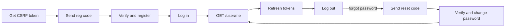

---

## CSRF and Postman

> [!IMPORTANT]
> **Every `POST` needs a valid CSRF token**, including registration and password-reset requests. `permitAll` allows unauthenticated access; it does **not** turn off CSRF checks.

### The rules

1. **Initialize the cookie.** Call `GET /auth/getCsrfToken` before the first `POST`. It sets the `XSRF-TOKEN` cookie and also returns the token in the response JSON.
2. **Send the header.** For each `POST`, send the current cookie value as the `X-XSRF-TOKEN` header. Postman may send the cookie automatically, but still add the header. The CSRF cookie is readable (not `HttpOnly`).
3. **Watch for rotation.** After a successful `POST /auth/login`, `POST /auth/verifyAndChangePassword`, or `POST /auth/refreshToken`, the server **rotates** the CSRF token. Read the new `XSRF-TOKEN` value from Postman's cookie jar and use it in the next `POST`. Don't keep using the old header value.
4. **After logout,** the authentication and CSRF cookies are cleared. Call `GET /auth/getCsrfToken` again before making further `POST` requests.

### Where to read the fresh token

Read it from the cookie itself for each `POST` instead of storing it somewhere. In Postman, open **Cookies** for `localhost`, find `XSRF-TOKEN`, and copy its current value into the `X-XSRF-TOKEN` header. The value in the `getCsrfToken` response helps for the first request, but the cookie is the source of truth after a rotation.

<details>
<summary><b>💡 Tip: automate the header with a Postman pre-request script</b></summary>

Add this to a collection-level **Pre-request Script** so every request picks up the current cookie value automatically:

```javascript
const token = pm.cookies.get('XSRF-TOKEN');
if (token) {
    pm.request.headers.upsert({ key: 'X-XSRF-TOKEN', value: token });
}
```

</details>

---

## 1. Get a CSRF token

| | |
| --- | --- |
| **Request** | `GET /auth/getCsrfToken` |
| **Auth required** | ❌ No |
| **CSRF header** | ❌ Not needed |
| **Body** | None |
| **Success** | `200 OK`; `csrfToken` in the JSON, `XSRF-TOKEN` cookie set |

Confirm that Postman saved the cookie for `localhost`.

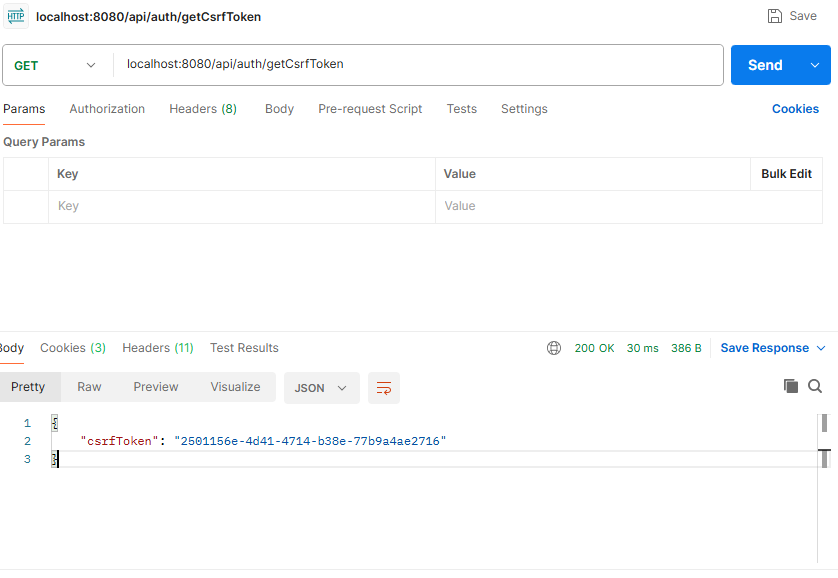

---

## 2. Send a registration verification code

| | |
| --- | --- |
| **Request** | `POST /user/sendRegCode` |
| **Auth required** | ❌ No |
| **CSRF header** | ✅ `X-XSRF-TOKEN` |
| **Body** | **raw / Text**: the email as plain text |
| **Success** | `200 OK` with a generic "code sent" message |

Enter the email as plain text, with no JSON object and no surrounding quotes:

```text
person@example.com
```

> [!NOTE]
> The same generic response is returned when the email is already registered, so the API doesn't disclose account status. Check the recipient's mailbox for the verification code.

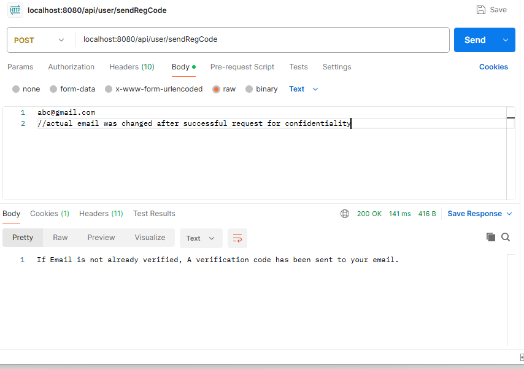

---

## 3. Verify the code and register a user

| | |
| --- | --- |
| **Request** | `POST /user/verifyAndRegisterUser` |
| **Auth required** | ❌ No |
| **CSRF header** | ✅ `X-XSRF-TOKEN` |
| **Body** | **raw / JSON** |
| **Success** | `201 Created`: `User Registered Successfully` |

```json
{
  "username": "sam",
  "email": "person@example.com",
  "password": "choose-a-password",
  "token": "CODE_FROM_EMAIL"
}
```

A wrong or expired code, a blocked attempt, or an already registered account returns a client error.

> [!NOTE]
> Registration does **not** log the user in. Call the login endpoint next.

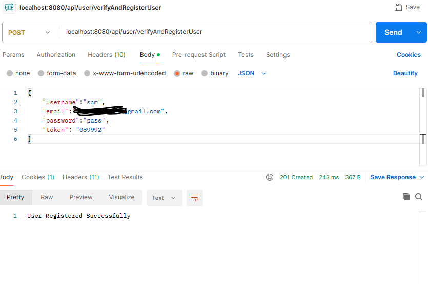

---

## 4. Log in

| | |
| --- | --- |
| **Request** | `POST /auth/login` |
| **Auth required** | ❌ No |
| **CSRF header** | ✅ `X-XSRF-TOKEN` |
| **Body** | **raw / JSON** |
| **Success** | `200 OK` with `username`, `role` and `email` |
| **Cookies set** | `jwt-t`, `refresh-t`; `XSRF-TOKEN` is **rotated** |

```json
{
  "email": "person@example.com",
  "password": "choose-a-password"
}
```

Keep the authentication cookies in Postman, then copy the newly issued CSRF cookie into the header before the next `POST`.

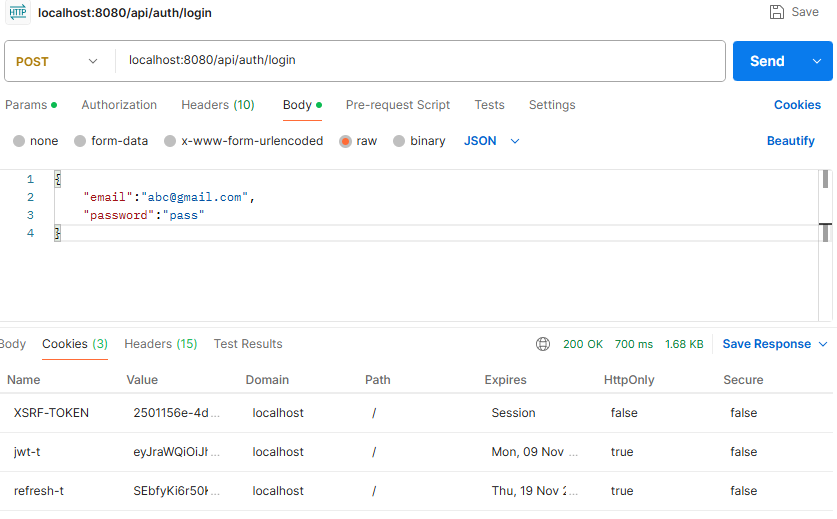

The second screenshot shows the `X-XSRF-TOKEN` header and the cookies returned after login:

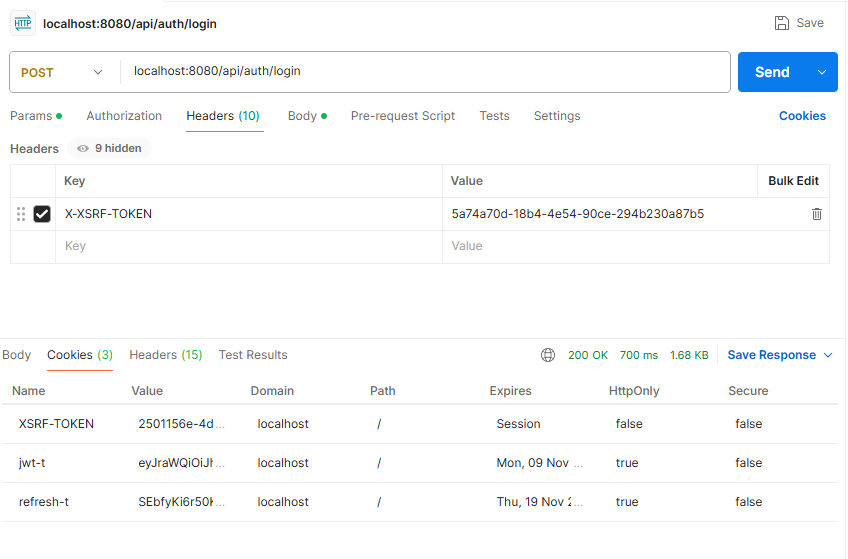

---

## 5. Get the current user's profile

| | |
| --- | --- |
| **Request** | `GET /user/me` |
| **Auth required** | ✅ `jwt-t` cookie |
| **CSRF header** | ❌ Not needed (it's a `GET`) |
| **Body** | None |
| **Success** | `200 OK` with username, authority and email |

Postman must send the `jwt-t` cookie from login (or from a later refresh or password reset). Without a valid authenticated cookie, the request is **unauthorized**.

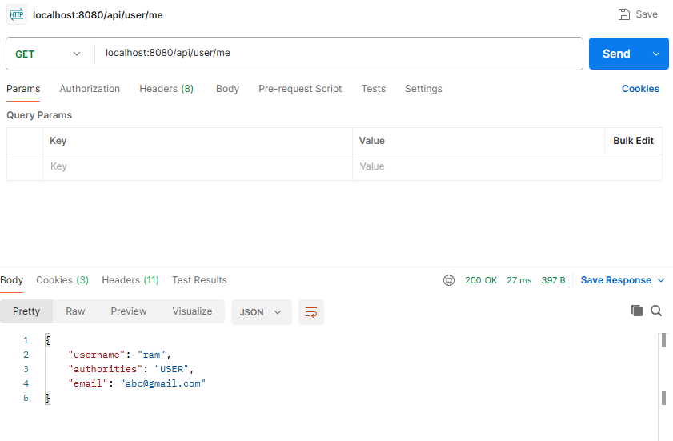

---

## 6. Refresh the access and refresh tokens

| | |
| --- | --- |
| **Request** | `POST /auth/refreshToken` |
| **Auth required** | ✅ valid `refresh-t` cookie |
| **CSRF header** | ✅ `X-XSRF-TOKEN` |
| **Body** | None |
| **Success** | `200 OK`; updated `jwt-t` and `refresh-t`; `XSRF-TOKEN` **rotated** |

Use the new CSRF cookie value for the next `POST`. The old refresh token is replaced, so use the cookie jar's updated value for future refreshes.

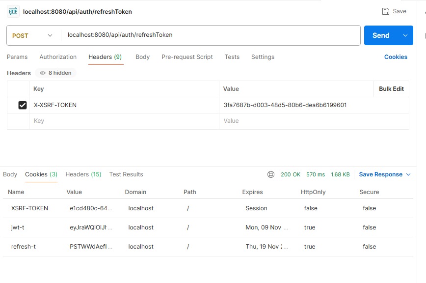

---

## 7. Log out

| | |
| --- | --- |
| **Request** | `POST /auth/logout` |
| **Auth required** | `refresh-t` cookie (revoked when present) |
| **CSRF header** | ✅ `X-XSRF-TOKEN` |
| **Body** | None |
| **Success** | `204 No Content`; `jwt-t`, `refresh-t` and `XSRF-TOKEN` cookies cleared |

> [!TIP]
> To keep testing `POST` endpoints after logout, call `GET /auth/getCsrfToken` first. To call `/user/me`, log in again.

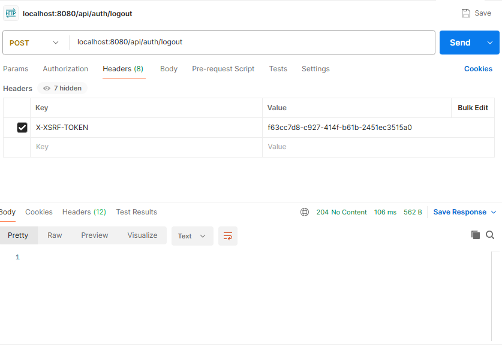

---

## 8. Request a password reset code

| | |
| --- | --- |
| **Request** | `POST /auth/forgetPasswordSendCode` |
| **Auth required** | ❌ No |
| **CSRF header** | ✅ `X-XSRF-TOKEN` |
| **Body** | **raw / Text**: the account email as plain text |
| **Success** | `200 OK` with a generic "code sent" message |

```text
person@example.com
```

Check the account's mailbox for the code.

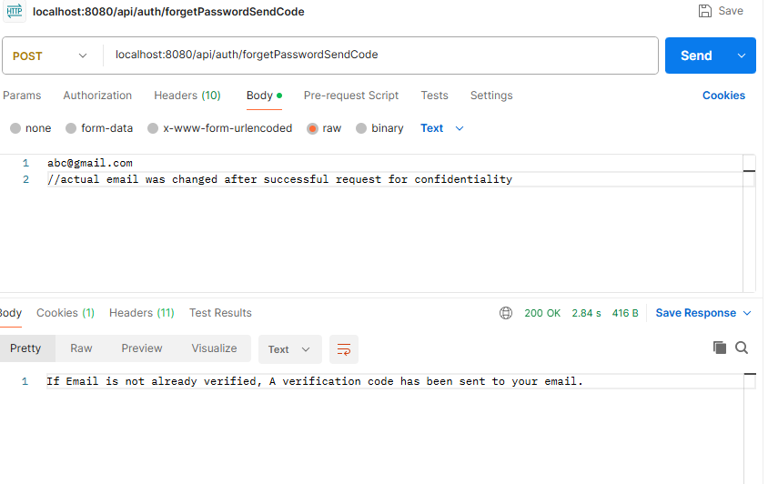

---

## 9. Verify the reset code and change the password

| | |
| --- | --- |
| **Request** | `POST /auth/verifyAndChangePassword` |
| **Auth required** | ❌ No |
| **CSRF header** | ✅ `X-XSRF-TOKEN` |
| **Body** | **raw / JSON** |
| **Success** | `200 OK` with the user's details |
| **Cookies set** | new `jwt-t` and `refresh-t`; `XSRF-TOKEN` **rotated** |

```json
{
  "email": "person@example.com",
  "newPassword": "a-new-password",
  "token": "CODE_FROM_EMAIL"
}
```

The endpoint also **signs the user in**. Update the Postman header from the new cookie before the next `POST`. An invalid or expired code, or a blocked attempt, returns an error response.

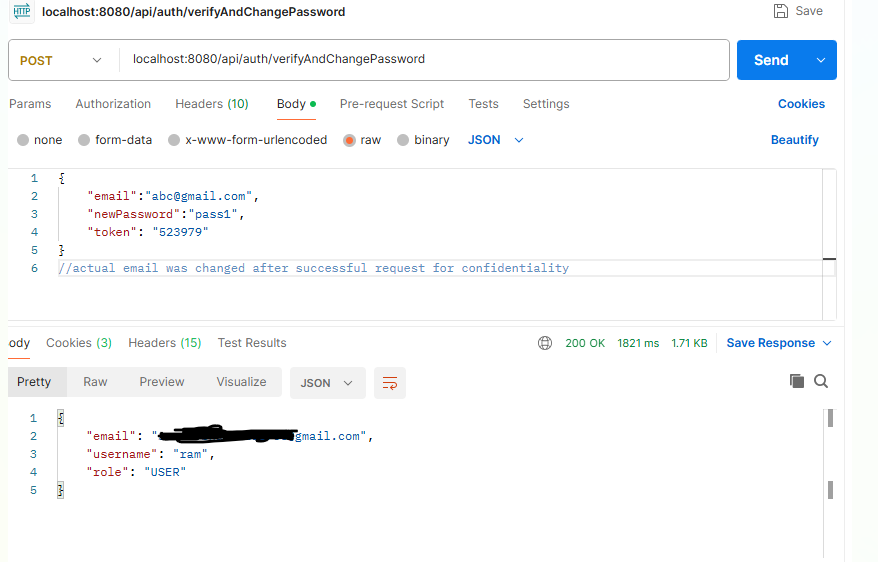

---

## 10. Sign in with Google

Google sign-in is an OAuth 2.0 **browser redirect flow**, not a JSON endpoint to call manually.

1. Open the following URL in a browser:

   ```text
   GET http://localhost:8080/api/oauth2/authorization/google
   ```

2. Complete Google's sign-in and consent steps.
3. On success, the application sets the `jwt-t`, `refresh-t` and `XSRF-TOKEN` cookies and redirects to the configured frontend dashboard.

> [!NOTE]
> Use a browser for this flow because Google's redirects and callback handling are part of the exchange. Configure valid Google OAuth credentials and the matching callback URL in Google Cloud. After sign-in, use the current CSRF cookie for `POST` requests as described above.

---

## Quick endpoint reference

| Method | Path | Body | Expected successful result |
| :---: | --- | --- | --- |
| `GET` | `/auth/getCsrfToken` | None | `200`; returns token and sets CSRF cookie |
| `POST` | `/user/sendRegCode` | Plain text email | `200`; generic code-sent message |
| `POST` | `/user/verifyAndRegisterUser` | JSON registration fields | `201`; user registered |
| `POST` | `/auth/login` | JSON email and password | `200`; auth cookies and rotated CSRF cookie |
| `GET` | `/user/me` | None | `200`; current user's profile |
| `POST` | `/auth/refreshToken` | None; uses refresh cookie | `200`; renewed auth cookies and rotated CSRF cookie |
| `POST` | `/auth/logout` | None | `204`; revokes refresh token and clears cookies |
| `POST` | `/auth/forgetPasswordSendCode` | Plain text email | `200`; generic code-sent message |
| `POST` | `/auth/verifyAndChangePassword` | JSON email, new password, code | `200`; changes password, signs in, rotates CSRF cookie |
| `GET` | `/oauth2/authorization/google` | Browser redirect | Redirects to Google; success redirects to frontend |
